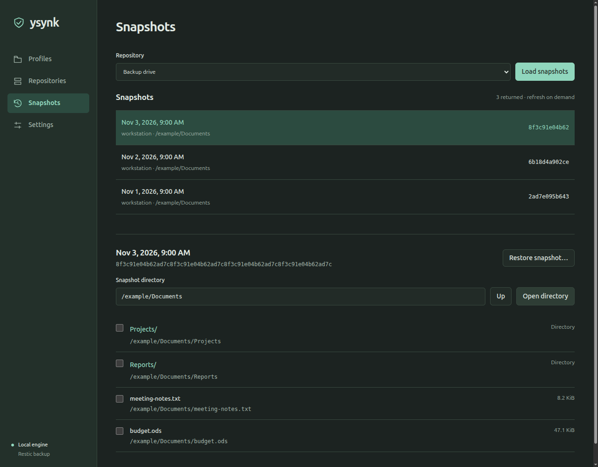

# ysynk

A desktop interface for [restic](https://restic.net/), built with Rust, Svelte
and Tauri. Backups use standard restic repositories. Repository passwords are
generated automatically and stored in the operating system's keychain.

## Screenshots

Screenshots show the application interface with sample data.




## Features

- Backup profiles with source paths, exclusions and multiple repositories.
- Manual backups and interval schedules while the app is running.
- Per-destination results, live command output and cancellation.
- Snapshot browsing and restoration to a new directory.
- Retention previews with explicit deletion confirmation; separate pruning.
- System keychain credentials and explicit password export for recovery.
- Light/dark themes, tray operation and Linux desktop notifications.
- Start at desktop login, optional minimized startup and persistent tray settings.

## Install

The [0.5.1 release](https://github.com/qvga/ysynk/releases/tag/v0.5.1) provides
Linux x86-64 assets. For Debian/Ubuntu, download the `.deb` and install it:

```sh
sudo apt install ./ysynk_0.5.1_amd64.deb
```

The package requires restic **0.17.1 or newer**, GTK3, WebKitGTK 4.1 and
AppIndicator. A persistent Secret Service keychain, such as GNOME Keyring or
a compatible KWallet provider, must be available in the desktop session.

The `.tar.gz` contains the same desktop executable and license notices, not a
self-contained runtime. Install the same system dependencies before running it.
Release assets include `SHA256SUMS` for integrity checks:

```sh
sha256sum --check SHA256SUMS
```

macOS and Windows builds are not provided. Their native keychain adapters have
not been validated. Safe restore and password export currently require Linux.

## Use

1. In **Repositories**, add a location and select **Initialize / retry**.
2. In **Profiles**, add source paths and select the repository destinations.
3. Select **Back up now**, or configure an interval. Schedules stop when ysynk
   exits; optional tray mode keeps it running when the window is closed.
4. In **Snapshots**, select a repository to browse and restore its snapshots.

Retention and prune operations are in **Repositories**. Deletion requires a
preview and confirmation. Existing restore output paths are not overwritten.

While an operation runs, **Command output** shows recent restic activity and
diagnostics. It follows new lines automatically; scroll up to read earlier
output, then select **Follow output** to return to the latest lines. Completed
output is available in operation history until the app closes. Only a bounded
tail is retained, not a complete command transcript.

### Start automatically

In **Settings → Startup and window behavior**:

1. Enable **Start at login**.
2. Enable **Hide to tray when the window closes** and confirm the tray icon is
   visible and its menu can be opened.
3. Optionally enable **Start minimized**, then save the settings.

These preferences persist across restarts. Minimized startup applies to login
launches only; opening ysynk manually shows the window. If a usable tray host is
unavailable at startup, the window remains visible. **Quit ysynk** stops the
application even when hide-to-tray is enabled.

Autostart runs after desktop login, not before login as a system service. Backup
profiles still need an interval; changes are not watched continuously. Backups
cannot run while the computer is off or asleep, and the desktop keychain and
repositories must be available. An executable archive must stay at the path
where autostart was enabled; after moving it, disable and re-enable autostart.
The checkbox reports registration state, not whether the registered executable
still exists. Login registration is unavailable for data-directory overrides
or executable paths containing spaces or unsupported special characters; the
Debian package uses a supported path.

If you previously followed the manual autostart instructions and created a
`ysynk.desktop` entry without `--autostart`, move that entry out of
`$XDG_CONFIG_HOME/autostart/` (normally `~/.config/autostart/`), then reload
Settings before enabling Start at login. Unrecognized existing entries are not
replaced automatically.

### Credentials and recovery

Keep an independent copy of every repository password. In **Settings → Export
repository password**, choose a repository, acknowledge the plaintext warning
and select a new file in the native save dialog. Store that file securely
outside backup sources and repositories. Anyone with its contents and access
to the repository can decrypt backups, even after the keychain is locked.

Removing a repository from ysynk does not delete its keychain entry. A surviving
repository and its password can be used with the unmodified restic CLI without
ysynk's configuration or history. Test recovery before relying on a backup.
See [security and recovery](docs/SECURITY.md) for the credential trust boundary.

### Current limitations

Existing repository password import and cloud-provider secret configuration
are not supported. Source paths that overlap application data or local
repositories are rejected. Linux Secret Service traffic uses unencrypted Plain
sessions over a trusted local user bus; do not use an untrusted or remote bus.

## Development

Use Rust 1.91.0 and Node.js 24.22.1, as pinned in the repository. Install Tauri's
Linux development prerequisites, restic and a persistent desktop keychain.

```sh
npm ci
./dev.sh
```

`dev.sh` builds the bundled frontend and a cached debug executable, then starts
the application. It does not install dependencies or start a frontend server.
For the application menu and the correct taskbar icon on GNOME/Wayland,
register the built executable once:

```sh
python3 tools/install-desktop-entry.py
```

This creates a user-local launcher pointing to this checkout's debug executable
and icon. Reopen ysynk afterwards. Pass a different executable path to register
a release build, and repeat registration if you move the checkout. Executable
paths containing `=` or `%` cannot be registered. Installed Debian packages
already include desktop integration.
Build, test and packaging commands are in [CONTRIBUTING.md](CONTRIBUTING.md).

## License

ysynk is [Apache-2.0](LICENSE). External restic uses the
[BSD 2-Clause license](docs/RESTIC-LICENSE). Release assets include third-party
notices. [Dependency notes](docs/DEPENDENCIES.md) describe the vendored fixes
and remaining advisory findings.
