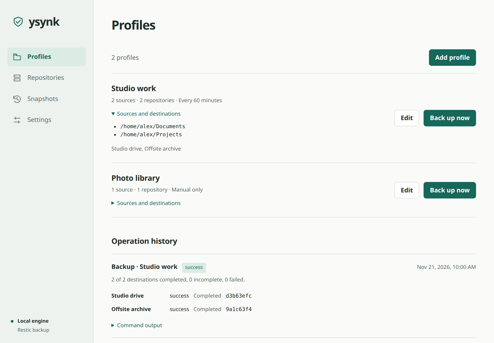

#  ysynk

**Encrypted backups for the Linux desktop, powered by restic.** Choose the folders you care about, back them up to one or more repositories, and browse snapshots when you need a file back. The repositories use restic’s standard format, so you can recover your files with restic itself.

[Download for Linux x86-64](https://github.com/qvga/ysynk/releases/latest) · [User guide](docs/guide.md) · [Security and recovery](docs/SECURITY.md)



## Install

Download the Debian package and `SHA256SUMS` from the same release. From the directory containing both files, run:

```sh
sha256sum --ignore-missing --check SHA256SUMS
sudo apt install ./ysynk_0.5.5_amd64.deb
```

Check that the package is listed as `OK` before installing. The package requires restic 0.17.1 or later, GTK3, WebKitGTK 4.1, and AppIndicator. Sign in to a Linux desktop with a persistent Secret Service keychain, such as GNOME Keyring. A standalone executable archive is also available for systems with those dependencies. [Archive installation](docs/guide.md#install-from-the-archive)

## Your first backup

1. In **Repositories**, add a new, empty destination and select **Initialize / retry**. For a local backup, choose a directory on a separate drive.
2. In **Settings**, choose **Export repository password**. Store the password somewhere you can reach if this computer fails. The exported file is plaintext.
3. In **Profiles**, add the source folders and select one or more destination repositories. Choose **Back up now** and check the result for each destination in **Operation history**.
4. In **Snapshots**, choose a repository and load its snapshots. Select a snapshot and restore a file to a **new directory**. Open the restored file to check your first backup.

Profiles support exclusions, interval schedules, and retention policies. Scheduled backups run while ysynk is open, including when it’s hidden in the tray. Removing old snapshots requires a deletion preview and confirmation. [Scheduling, restoring, and retention](docs/guide.md)

## Development

The desktop shell uses Tauri and Svelte. The Rust core runs restic, coordinates jobs, and handles keychain access. The supported release target is Linux x86-64. [Build and test from source](CONTRIBUTING.md) · [Dependency notes](docs/DEPENDENCIES.md)

ysynk is licensed under [Apache-2.0](LICENSE). Restic is distributed separately under the [BSD 2-Clause license](docs/RESTIC-LICENSE).
