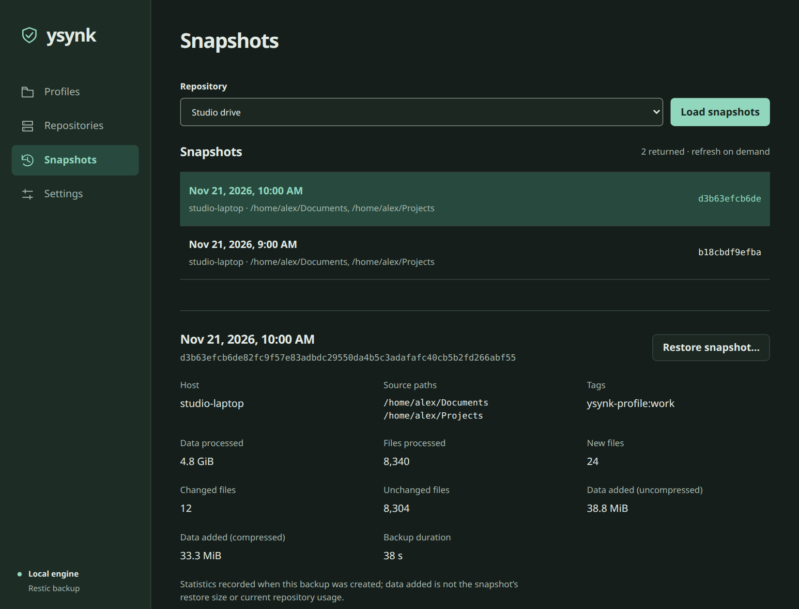

# Using ysynk

## Install from the archive

Download the Linux x86-64 archive and `SHA256SUMS` from the same [release](https://github.com/qvga/ysynk/releases/latest). Run `sha256sum --ignore-missing --check SHA256SUMS` and check that the archive is listed as `OK`. Extract it to a directory you intend to keep, and start `./ysynk-desktop` there. The archive uses the same system libraries and Secret Service keychain as the [Debian package](../README.md#install).

To add an application-menu entry and taskbar icon, run this from the extracted directory, then reopen ysynk:

```sh
python3 tools/install-desktop-entry.py ./ysynk-desktop
```

The launcher refers to the extracted executable and icon. Before moving the archive directory, disable Start at login and remove the launcher you created from `~/.local/share/applications/` (or `$XDG_DATA_HOME/applications/`). After the move, run the registration command again.

## Repositories and profiles

A **repository** stores encrypted snapshots. A **profile** describes what to back up, which repositories to use, and when to run. A single profile can back up the same folders to several destinations. See [Your first backup](../README.md#your-first-backup) for the setup sequence.

Use absolute paths for local repositories and source folders. A source and a local repository must occupy separate directory trees, outside ysynk’s application data. For remote repositories, use a restic backend location and configure access for the desktop user. The app generates its own repository passwords. Importing an existing repository password and configuring cloud-provider secrets in the app are currently unsupported.

During a job, the activity bar shows recent command output, progress when available, and a cancellation control. Scroll up to read an earlier line, then select **Follow output** to resume following new lines. Each destination has its own result. Recent command output stays in memory until ysynk exits and can include private paths.

## Schedules and desktop login

Set an interval in the profile to run backups while ysynk is open. A sleeping or powered-off computer cannot run a scheduled job. Remote destinations need a connection and the desktop keychain must be available.

In **Settings → Startup and window behavior**, enable **Start at login** to launch ysynk after desktop sign-in. To keep it running when you close the window, enable **Hide to tray** and confirm you can open its tray menu. **Start minimized** requires both settings. Save the settings after making changes. A manual launch opens the window. **Quit ysynk** stops scheduling.

A stale or unrecognized login entry can prevent registration. If Settings reports that the executable moved, move the old `ysynk.desktop` out of `$XDG_CONFIG_HOME/autostart/` (usually `~/.config/autostart/`), reload Settings, then enable Start at login. This also applies to older manually created entries without `--autostart`. Data-directory overrides and executable paths with unsupported desktop-entry characters cannot register for login.

## Restore files

Open **Snapshots**, select a repository, and choose **Load snapshots**. Each snapshot records a point in time. Where restic supplies a summary, ysynk shows counts and sizes from that backup. Data added measures new repository data at the time of backup.



Select a snapshot to restore it in full, or browse its files and select individual paths. Enter a new output directory under an existing parent. Restic verifies the restored data. If a restore fails or you cancel it, inspect the incomplete directory and choose another new target for a retry.

For recovery on a replacement computer, keep the repository, its password, and any separate credentials for the remote host. You can restore using restic without the original installation. [Recover independently of ysynk](SECURITY.md#independent-recovery)

## Retention and maintenance

In **Repositories**, open the repository’s tools to check integrity, inspect statistics, or preview a profile’s retention policy. Review which snapshots the preview would remove and how many would remain. The latest successful preview expires after five minutes. Applying it requires typing `DELETE`.

Pruning reclaims unreferenced storage across the **whole repository**. It is a separate operation and requires typing `PRUNE`. Let other maintenance clients finish before applying retention or pruning. Removing a profile or repository from ysynk’s configuration leaves the stored snapshots and keychain credential in place.
