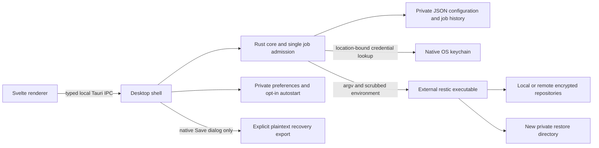

# Security and reliability review · November 2026

This is the historical review for the 0.5.1 release. For current behavior and dependency status, see [Security and recovery](../SECURITY.md) and [Dependency notes](../DEPENDENCIES.md).

Audit date: 2026-11-03. Baseline: `eb85782` (`main`), origin
`git@github.com:qvga/ysynk.git`. The initial working tree was clean.

## Executive summary

This is a local desktop backup application, not a multi-tenant web service.
The first assessment found credential-locator validation, password-export
publication, scheduling, persistence-error handling, subprocess cancellation,
and frontend workflow defects despite a passing baseline test suite.
No authentication service, SQL database, payment integration, container
configuration, or CI deployment workflow exists in the tracked repository.

Fourteen confirmed first-party findings were remediated for the Linux release
target, with regression tests and a second sensitive-code review. No confirmed
critical or high-severity exploit remained in reviewed first-party code. Final
checks pass: 26 Rust, 13 frontend and 14 tooling tests; formatting, Clippy,
frontend type checking, production builds and Debian packaging. Dependency
advisories, external-runtime reachability and native/platform validation remain
explicit limitations, not a clean-security claim.

Existing safeguards include typed local-only native IPC, a restrictive renderer
CSP, native-only password export, persistent location-bound keychain records,
credential-creation locks, no shell command construction, bounded restic output,
explicit retention/prune confirmation, and non-overwriting verified restores.
Passing tests and these controls do **not** establish absence of vulnerabilities.

## Scope and architecture

All tracked first-party source, tests, manifests, lockfiles, scripts, packaging,
and documentation were inventoried and reviewed. The two vendored patches were
reviewed and compared with upstream archives; the entire upstream GLib library
and every transitive dependency were **not** independently line-audited.
Ignored build output, local IDE configuration, user backup data and live
credentials are not application-source audit targets.



- Rust 1.91.0, Tauri 2.12.5, Svelte 5.57.3, TypeScript 6.0.3,
  Node.js 24.22.1; exact dependencies are pinned and locked.
- Linux x86-64 is the release target. The verification host has restic 0.18.1,
  GTK 3.24.52, WebKitGTK 2.52.6, AppIndicator 0.5.94 and D-Bus 1.16.2.
- Core entry points are typed requests, native password export, scheduler ticks
  and shutdown. Workers serialize repository operations per application data
  directory; initialization also locks the shared credential namespace.
- Native startup/tray/settings, manual backup, scheduled backup, initialization
  retry, listing, restore, retention preview/apply, prune, password export,
  polling and shutdown were traced across component boundaries.
- The signed-in user, OS keychain, restic binary, transport helpers and host are
  trusted. Same-user malware/root, hostile remote session buses and compromised
  operating-system libraries are outside the documented protection boundary.
- Security categories assessed but not applicable as web-server features:
  cookies, JWT/OAuth, CSRF, tenant/role isolation, SQL/NoSQL, uploads, payment
  transactions, container privileges and infrastructure migrations.

## Findings

Severity reflects demonstrated impact and preconditions in this local desktop
application, not an assumed remotely accessible service.

| ID | Severity | Component | Confirmed issue | Current status |
| --- | --- | --- | --- | --- |
| A-01 | Medium | Repository validation | Multiple `@` separators bypass embedded-password rejection | Fixed |
| A-02 | Medium | Password export | Shared-directory staging can publish substituted contents | Fixed on Linux; other platforms fail closed |
| A-03 | Medium | Scheduler | First-due selection can indefinitely starve later profiles | Fixed |
| A-04 | Medium | Job admission | Failed persistence advances attempts without running a backup | Fixed; post-publication recovery caveat |
| A-05 | Medium | Configuration save | Post-replacement sync failure leaves stale memory operational | Fixed by fail-closed admission |
| A-06 | Medium | Subprocess management | Detached pipe holders defeat timeout/cancellation | Fixed on Unix; Windows unresolved |
| A-07 | Medium | Restore UI | Modal dialog prevents reaching cancellation during restore | Fixed |
| A-08 | Medium | Job polling | Evicted completion leaves pending promises/UI busy indefinitely | Fixed |
| A-09 | Medium | Filesystem inputs | Trimming silently changes valid paths and patterns | Fixed |
| A-10 | Low | Accessibility | Form boundaries fail 3:1 non-text contrast | Fixed |
| A-11 | Low | Advisory tooling | Incorrect package identities and incomplete npm inventory acceptance | Fixed |
| A-12 | Medium | Retention | Repeated previews accumulate outside retained-result budget | Fixed |
| A-13 | Medium | Password export | Published directory entry was not synced before success | Fixed |
| A-14 | Low | Retention | Empty repositories produce an incorrect JSON-error result | Fixed |
| D-01 | Maintenance risk | Dependencies | Locally patched and unmaintained dependencies remain | Partially mitigated / unresolved |
| D-02 | Unassessed | External runtime | Installed restic's Go runtime has advisory version matches | Not verified; system package unchanged |

### A-01 — Embedded backend credentials persisted despite validation

- **Location/root cause:** `config.rs::validate_shape` examined URL userinfo
  before the first `@`, rather than the final authority separator.
- **Evidence/impact:** a locator containing multiple separators and a password
  could pass SaveConfig and enter private JSON and renderer Status. This is
  confidentiality-policy failure, not a demonstrated remote authentication
  bypass: it requires a supplied secret and subsequent access to that data.
- **Fix:** inspect URL userinfo before the final authority separator and reject
  colon or percent there. Preserve email-like usernames and legacy SCP-style
  SFTP acceptance; SCP paths/usernames are not URL password fields.
- **Tests/result:** `audit_save_rejects_ambiguous_credentials_without_exposing_them`
  and `audit_save_preserves_username_ipv6_and_path_separators` pass. Rejection
  checks cover error text, configuration, history, status and no keychain read.
- **Second-pass compatibility check:** initially rejecting every additional `@`
  broke existing relative SFTP locators. Upstream restic parser review corrected
  that assumption. `existing_sftp_locators_keep_their_exact_keychain_binding_on_load_and_save`
  reproduced the regression, then passed after restoring compatible acceptance.
  It verifies exact location binding across load/save without remote access.
- **Remaining action:** no live credentials were inspected or rotated. Users
  who previously entered such a locator should remove the embedded credential
  and assess exposure; any live rotation requires their authorization. Existing
  unsafe configurations now fail validation. Do not blindly rewrite a locator
  bound to a keychain record: preserve the record/password and verify independent
  restic recovery before changing configuration. No automatic migration occurs.

### A-02 — Recovery export trusted a replaceable staging pathname

- **Location/root cause:** `runtime.rs::export_repository_password` staged and
  published through ordinary paths without checking parent ownership/write
  permissions. Another user with deletion rights in a non-sticky shared folder
  could substitute staging contents, producing a falsely successful recovery file.
- **Fix:** before credential access, open a no-symlink parent chain, require a
  trusted owner and safe mode/sticky semantics, and pin the parent descriptor
  through staging, publication and cleanup. Files remain new-only and `0600`.
- **Tests/result:** `audit_export_rejects_untrusted_parent_before_reading_credentials`
  and `audit_export_pins_parent_across_ancestor_rename_and_symlink_replacement`
  pass, along with the existing extensive export regression. The original
  shared-parent acceptance failed the new negative test.
- **Remaining limits:** tests simulate permission and rename attacks under one
  UID; no cross-user login was used. Same-user/root adversaries remain trusted.
  Safe export now fails closed off Linux; this limitation is documented rather
  than claiming untested descriptor semantics on other platforms.

### A-03 — Overdue scheduled profiles could starve

- **Location/root cause:** `runtime.rs::tick` selected the first due profile in
  configuration order. Long-running earlier profiles could alternate forever.
- **Fix:** select the oldest due deadline using one captured clock value and
  saturating interval arithmetic, retaining completion-relative scheduling.
- **Tests/result:** `audit_scheduler_selects_oldest_deadline_after_each_completion`
  failed before the fix and passes with three overdue profiles, different
  intervals, repeated completions and overflow-boundary timestamps.
- **Remaining limits:** schedules still run only while the application is open;
  no concurrent backup workers or operating-system scheduler was introduced.

### A-04 / A-05 — Persistence failures left unsafe operational state

- **Location/root cause:** `runtime.rs::request` updated attempts before saving
  admission; failure only cleared the active job. Configuration writes in
  `config.rs::write` replace the file before directory sync, so a later failure
  left old in-memory configuration and preview tokens operational.
- **Impact:** a backup that never started could silently delay retries; disk and
  memory could disagree about destinations/policy after a failed save.
- **Fix:** failed admission restores in-memory attempts. Any configuration,
  admission or completion persistence failure latches a visible restart-required
  error, clears preview tokens and blocks further saves, exports and jobs.
  Completed jobs retain their current-process outcome instead of being lost.
- **Tests/result:** `audit_write_failures_block_admission_and_clear_previews`,
  `audit_failed_admission_preserves_attempts_and_blocks_retry` and
  `audit_completion_write_failure_preserves_outcome_and_blocks_jobs` pass.
  Thread-local injected failures cover both pre-publication and post-publication
  directory-sync errors; assertions include disk state and absence of workers
  or credential reads. New failure-path assertions failed before remediation.
- **Remaining recovery caveat:** publication cannot safely be rolled back by
  pathname. Restart reloads the published state; a committed admission without
  completion is reported interrupted and may retain its attempt timestamp.
  Fix filesystem access, restart, inspect history and manually retry as needed.

### A-06 — Detached pipe holders bypassed subprocess deadlines

- **Location/root cause:** `restic.rs::run_inner` unconditionally joined blocking
  stdout/stderr/stdin threads after reaping the direct child. A descendant in a
  separate session retained pipes beyond process-group termination.
- **Impact:** version probing, cancel and shutdown could hang indefinitely;
  ordinary restic operation need not encounter this conditional helper failure.
- **Fix:** Unix parent pipe endpoints are nonblocking and worker I/O is
  interruptible. Draining after exit checks cancellation/timeouts and has a
  one-second ceiling. Incomplete output is an error, never successful recovery.
- **Tests/result:** all four new `restic::tests` failed against the original code
  at about four seconds, then passed together in 1.04 seconds. They cover output
  timeout, cancellation, a blocked input writer, and exit without a timeout.
  Disposable detached helpers have bounded lifetimes and explicit cleanup.
- **Remaining limits:** no arbitrary detached process is discovered/killed;
  only owned process groups are terminated. Windows detached-pipe handling is
  unchanged and remains unresolved; Windows is not a release target.

### A-07 — A running restore trapped users in a modal dialog

- **Location/root cause:** `Snapshots.svelte::closeRestore` refused dismissal
  while restoring, and the modal made the external cancel control inert.
- **Fix:** allow dismissal without cancelling the operation, keep captured
  request/result ownership, show errors outside the dialog when dismissed, and
  return focus to the activity bar when the original trigger is disabled.
- **Tests/result:** the offline browser fixture reproduced the original trap.
  `ui/audit-interactions.mjs` verifies dismissal sends no cancel, cancellation
  can then be sent once, and incomplete-output warnings remain visible. Pointer
  and real keyboard Tab/Shift+Tab/Escape/Enter checks passed in Chrome.
- **Limit:** browser evidence uses mocked IPC; native dialog/window integration
  was not exercised against a live application.

### A-08 — Missing historical completion could permanently block the UI

- **Location/root cause:** `App.svelte` settled a pending promise only when its
  job appeared in history, while native history retains only 100 entries.
- **Fix:** `JobCompletions` uses monotonically sequenced polling. Only a status
  request initiated after admission can settle a job or report that its result
  is no longer available. Busy state is released on that explicit error.
- **Tests/result:** four `jobs.test.ts` cases cover stale pre-admission polls,
  eviction among 100 newer jobs, fast completion, teardown and subsequent
  admission. Browser fixtures reproduced the original permanent-busy behavior
  and now pass stale-poll and eviction recovery checks.
- **Compatibility:** native request/response schemas and persisted state are
  unchanged; no premature inference is made from cached/pre-admission status.

### A-09 — Valid filesystem names and exclusions were silently rewritten

- **Location/root cause:** `model.ts::lines`, repository submit and restore
  submit called `trim()` on filesystem/pattern values. A trailing space can
  distinguish two real files/directories or change an exclusion's meaning.
- **Fix:** preserve literal values; separate CRLF/LF lines and discard only
  empty lines. Human-readable labels still trim independently.
- **Tests/result:** `model.test.ts` covers whitespace-preserving paths/patterns.
  Browser checks verified unchanged profile edit/save, repository locations,
  and restore request targets with whitespace. Core path validation still
  rejects unsupported inputs instead of silently normalizing them.

### A-10 — Unfocused form controls had insufficient boundary contrast

- **Location/root cause:** `style.css` reused a decorative separator color for
  inputs, textareas and selects; border/fill contrast was approximately 1.35:1
  light and 1.56:1 dark.
- **Fix:** a dedicated `--control-border` token, leaving decorative lines alone.
- **Tests/result:** `ui/contrast.test.mjs` asserts at least 3:1 against control
  fill and page backgrounds in all theme declarations. Browser-computed ratios
  were 3.45–3.59 light and 4.30–4.74 dark; light/dark/system and both window sizes
  were checked. Disabled controls are not included in this WCAG requirement.

### A-11 — Advisory inventory could misidentify or omit npm dependencies

- **Location/root cause:** `tools/check_advisories.py` inferred package names
  from all lockfile paths and accepted a missing `packages` inventory as empty.
- **Evidence/impact:** the actual lockfile generated a spurious
  `vendor/deepmerge` package query; alias fixtures queried the alias instead of
  its upstream name. A malformed/incomplete inventory could produce a false
  clean result. There are no affected aliases in the current lockfile.
- **Fix:** accept supported complete lockfile inventories, query actual npm
  installation entries by upstream name, and retain explicit local-backport
  manifest queries. No findings are suppressed.
- **Tests/result:** three new tests failed before the fix; all five inventory,
  incomplete-response/pagination and finding-status tests now pass. Repeated
  OSV analysis checks 575 real entries rather than 576 and retains the same six
  affected packages, returning exit status 1 as intended.

### A-12 — Retained preview memory had no count/aggregate bound

- **Location/root cause:** `runtime.rs::preview` retained every successful
  preview for five minutes. Each could hold another near-8-MiB JSON result,
  outside the history-result budget. Expiry and serialized execution bound time
  and throughput, not dependable retained memory.
- **Fix:** retain only the latest successful preview globally; failed generation
  preserves the prior valid token. Superseded-token errors are explicit.
- **Tests/result:** `only_the_latest_successful_retention_preview_remains_valid`
  failed at two retained previews before the fix. It now passes successive and
  cross-repository replacement, failed replacement, stale-token refusal and
  latest-token application using two disposable real restic repositories.
- **Contract/limits:** the documented latest-preview policy intentionally
  invalidates earlier tokens. Heap/RSS exhaustion was not induced or benchmarked;
  one bounded parsed result still has overhead beyond its serialized byte size.

### A-13 — Recovery export did not establish directory-entry durability

- **Location/root cause:** export synced staged file contents, but returned
  success immediately after publication without syncing the parent directory.
  A crash could lose the name of the supposedly completed recovery file.
- **Fix:** sync the pinned parent after publication. On failure, explicitly
  report that the file was written but durability is uncertain; never delete it
  through a rollback path.
- **Tests/result:** `export_sync_failure_preserves_the_published_file_and_releases_admission`
  failed before the sync hook was added and now passes: contents and `0600` mode
  remain, the reservation releases and retry refuses to overwrite the file.
- **Limit:** fault injection verifies application semantics, not physical
  power-loss guarantees of every filesystem/storage device.

### A-14 — Empty retention results were misread as malformed JSON

- **Location/root cause:** `runtime.rs::preview` assumed every successful
  `forget --dry-run --json` emitted JSON. A real empty restic 0.18.1 repository
  emitted zero stdout bytes; upstream `cmd_forget.go` confirms output is omitted
  when there are no groups.
- **Fix:** only this successful retention command may translate zero bytes to
  an empty group list. Nonzero exits and nonempty malformed output still fail.
- **Tests/result:** `retention_preview_of_an_empty_repository_has_no_candidates`
  reproduced the failure and now returns zero candidates and zero kept snapshots.
  Existing real-restic tests still verify deletion of only previewed snapshots.

### D-01 / D-02 — Dependency and external-runtime follow-up

The six locked-package findings remain visible; local source patches mitigate
the two specific GLib/deepmerge issues, while four maintenance advisories remain
unresolved. No unsupported major dependency migration was attempted.

`restic version` and `go version -m /usr/bin/restic` identify the external test
binary as restic 0.18.1 built with Go 1.25.0. A separate OSV query returned zero
restic module matches and **60 Go standard-library version matches**, recorded
in [the runtime snapshot](../audit-runtime-advisories.json). These are **not
60 confirmed exploitable application vulnerabilities**: distribution backports,
compiled symbol reachability and hostile-input paths were not verified. An
operator should assess/update the system restic build through the normal package
process; changing the host package was outside this repository remediation.

## Baseline verification

| Command/check | Baseline result |
| --- | --- |
| `cargo fmt --all -- --check` | Passed |
| `cargo test --workspace --locked` | 7 core and 3 desktop tests passed |
| `cargo clippy --workspace --locked --all-targets -- -D warnings` | Passed; vendored GLib emits 34 pre-existing upstream warnings |
| `npm run check` | 0 errors, 0 warnings |
| `npm test` | 7 tests passed in 2 files |
| `npm run test:dependencies` | Actual Svelte-plugin resolution check and 22 merge regressions passed |
| `npm run build` | Passed |
| `python3 -m unittest discover -s tools -p 'test_*.py'` | 9 passed |
| `python3 tools/check-backports.py` | Passed |
| `python3 tools/release-notices.py` | Offline inventory generated, 3,019,240 bytes |
| `npm run desktop:build -- --no-bundle` | Native optimized release build passed |
| `sh -n dev.sh packaging/build-deb.sh` | Passed |
| `node --check` on dependency checker and all three deepmerge entry points | Passed |
| Optimized vendored GLib backport tests | 6 focused regressions and 11 upstream iterator tests passed |
| `npm audit --json` | Zero reported npm advisories; this does not clear local-file backports |
| `python3 tools/check_advisories.py --output target/audit-advisories-baseline.json` | Exit 1: six package findings retained, 576 queried entries |

GLib commands:

```sh
cargo test --release --offline --manifest-path vendor/glib/Cargo.toml --test variant_str_iter_backport
cargo test --release --offline --manifest-path vendor/glib/Cargo.toml --lib variant_iter::tests
```

### Dependency and secret analysis

- OSV returned the same six package findings as the pre-existing report:
  deepmerge 4.3.1 (`GHSA-gcqx-w48m-w2h4`), GLib 0.18.5
  (`GHSA-wrw7-89jp-8q8g`, `RUSTSEC-2024-0429`), proc-macro-error 1.0.4
  (`RUSTSEC-2024-0370`), zbus_names 4.3.5 (`RUSTSEC-2026-0371`),
  zvariant and zvariant_derive 5.15.1 (`RUSTSEC-2026-0370`,
  `RUSTSEC-2026-0372`). The last four are maintenance advisories, not four
  demonstrated application exploits.
- Registry metadata confirms the pinned single-instance plugin 2.5.5 remains
  its latest stable version. Its zbus dependency cannot simply be replaced with
  a different major version without an integration migration.
- The GLib archive checksum matched the documented upstream archive. All 121
  published files were compared: only the documented iterator file differs;
  the focused regression file is the sole addition.
- The deepmerge archive checksum matched its documented upstream archive.
  Differences were confined to the documented source/distribution patch and
  package metadata; only the documented upstream `.eslintcache` is omitted.
- Registry dependencies have lockfile checksums/integrity records. There are
  no Git-sourced packages; local overrides are GLib and deepmerge. The only npm
  install-script marker is the optional platform dependency `fsevents`.
- A redacted heuristic scan of all 193 tracked text files checked private-key
  headers, common cloud/GitHub/payment token formats and credential-bearing URLs.
  Its two candidates are deliberate negative-test fixtures. No live secret was
  confirmed. This is not an exhaustive entropy scan or Git-history secret audit.
  The repeated final scan included 202 tracked/new text files; all five candidate
  locations were negative-test fixtures. No matched values were printed.
- No proprietary source or credentials were uploaded. External checks used only
  public dependency names/versions, public documentation and upstream archives.

## Changes and final verification

### Changed files

| Files | Purpose |
| --- | --- |
| `crates/core/src/config.rs` | Correct URL-userinfo validation; test-only persistence fault injection |
| `crates/core/src/runtime.rs` | Pinned/durable export, persistence failure latch, fair scheduling, bounded previews, empty retention handling |
| `crates/core/src/restic.rs` | Cancellable Unix pipe I/O and bounded post-exit draining |
| `crates/core/src/tests.rs` | Negative, persistence, scheduling, export, retention and locator-compatibility regressions |
| `crates/core/src/restic_tests.rs` | Four isolated detached-pipe regressions |
| `ui/src/App.svelte` | Post-admission status sequencing and completion reconciliation |
| `ui/src/lib/jobs.ts`, `ui/src/lib/jobs.test.ts` | Small testable completion tracker and four regression tests |
| `ui/src/lib/Dialog.svelte` | Restore focus to an enabled control after dismissal |
| `ui/src/lib/Snapshots.svelte` | Dismissible running restore, literal destination, visible deferred errors |
| `ui/src/lib/Repositories.svelte` | Preserve literal repository locations |
| `ui/src/lib/model.ts`, `ui/src/lib/model.test.ts` | Preserve source/exclusion whitespace and test line splitting |
| `ui/src/style.css`, `ui/contrast.test.mjs` | Accessible form-boundary token and contrast regression |
| `ui/audit-fixture.mjs`, `ui/audit-interactions.mjs` | Reproducible offline browser harness with synthetic IPC only |
| `tools/check_advisories.py`, `tools/test_advisories.py` | Correct dependency identities, fail closed on incomplete inventories, five tests |
| `docs/advisories.json` | Repeated OSV results with corrected 575-entry inventory |
| `docs/audit-runtime-advisories.json` | Explicitly unverified external Go-runtime advisory snapshot |
| `docs/SECURITY.md` | Export/preview/persistence behavior, compatibility recovery and platform limitations |
| `docs/DEPENDENCIES.md` | Scanner scope, local backports and external-runtime follow-up |
| `README.md` | Linux-only safe export limitation |
| `CONTRIBUTING.md` | Python fixture prerequisite and offline browser reproduction |
| `AUDIT_REPORT.md` | Assessment, findings, evidence and outstanding actions |

No dependencies, lockfile versions, persisted schemas, native IPC shapes,
capabilities or deployment configuration changed. New abstractions are limited
to a small frontend completion tracker and the bounded pipe-I/O adapter; no new
service, queue or framework was introduced. Earlier successful retention tokens
are now deliberately superseded by a new successful preview. Export rejects
unsafe parents and unsupported platforms rather than claiming unverified safety.

No database migration or automatic data conversion is needed. Rebuild/install
through the normal release process when authorized; the generated package was
**not installed or published**. Review previously stored unsafe URL locators
and recovery credentials before editing their location bindings. Correct
filesystem failures before restarting a latched application.

### Final checks

| Command/check | Final result |
| --- | --- |
| `cargo fmt --all -- --check` | Passed |
| `cargo test --workspace --locked` | **23 core + 3 desktop passed**, zero ignored; doc tests passed |
| `cargo clippy --workspace --locked --all-targets -- -D warnings` | Passed; same 34 vendored upstream warnings |
| `npm run check` | 0 errors, 0 warnings |
| `npm test` | **13 passed** in 4 files |
| `npm run test:dependencies` | Resolution check and **22 regressions passed** |
| `python3 -m unittest discover -s tools -p 'test_*.py'` | **14 passed** |
| `python3 tools/check-backports.py` | Passed after remediation |
| `python3 tools/check_advisories.py --output docs/advisories.json` | Exit **1**, expected: same six affected packages; no suppression |
| `sh -n dev.sh packaging/build-deb.sh` | Passed |
| `node --check ui/audit-fixture.mjs` / `ui/audit-interactions.mjs` | Passed |
| `sh packaging/build-deb.sh` | Offline notices, frontend production build, optimized native build and Debian bundle passed |
| `dpkg-deb --field` / `--contents` on built package | Dependencies, executable, desktop entry, icon and all three license inventories present |
| `git diff --check` | Passed |
| Redacted secret-pattern scan | No live secret confirmed; test-fixture matches only |

The final package is `target/release/bundle/deb/ysynk_0.5.1_amd64.deb`
(approximately 4.22 MiB). Native logs are retained locally in
`target/audit-workspace-tests.log`, `target/audit-clippy.log` and
`target/audit-package-build.log`. Ignored build/test artifacts are not source
deliverables. Vendored optimized GLib tests and provenance comparisons remain
valid because no vendored bytes or dependency selections changed.

First-party automated test cases increased from **26 to 53** (Rust, frontend,
Python combined). This is a test-count change, **not measured line/branch
coverage**. Regression failures were observed before the relevant corrections;
new positive compatibility/boundary tests supplement them. No legitimate baseline
test was removed or weakened. Incorrect new SCP-password assumptions were
corrected against upstream parsing semantics and replaced with binding-preserving
compatibility coverage.

### Browser and repeat-review evidence

Chrome DevTools exercised the real bundled frontend in a separate offline
fixture using only in-memory IPC. At **1120×800** and **720×580**, checks covered
light/dark/system themes, reduced motion, loading/empty/error states, literal
request values, stale polls, history eviction, restore dismissal/cancellation,
and keyboard Tab/Shift+Tab/Escape/Enter behavior. No JavaScript console errors
or failed network requests were observed; an existing form id/name advisory
remains. Screenshots were inspected at
`target/audit-ui/{1120,720}-{light,dark}-final.png`.

This is renderer integration/visual evidence, **not native end-to-end testing**.
The harness cannot validate WebKit/Tauri CSP enforcement, native picker behavior,
OS keychains or real remote transport.

The repeat security review covered all sensitive core changes. It found the
additional preview-memory and export-durability defects, and caught the SFTP
compatibility regression before completion. Those were corrected and checked
again; the reviewer approved the narrowed URL/SCP policy. No additional
actionable first-party finding remained in the performed review passes. This
does not extend to untested environments or establish a vulnerability-free system.

## Outstanding risks and limitations

- Native credential-provider behavior, live remote backends, independent
  disaster recovery, real native picker/tray behavior, and macOS/Windows remain
  unverified in this run. Automated tests use injected credentials and disposable
  local repositories, never the user's keychain.
- Linux Secret Service Plain sessions still rely on a trusted local user bus.
  Enabling the dependency's weak DH randomness is not an acceptable workaround.
- External restic clients can race retention verification and deletion between
  commands. No cross-process transaction is claimed; stop other maintenance
  clients before applying retention. Repository-wide prune remains explicit.
- OS packages and the complete third-party dependency source tree are not
  independently audited. No standalone SAST/secret scanner, sanitizer, fuzzing
  campaign or line/branch coverage instrument was installed. Existing Clippy,
  type checks, focused negative tests and dependency checks were used instead.
- The six locked-package findings remain partially mitigated/unresolved as
  described in D-01. D-02's 60 external Go-runtime version matches require
  operator assessment; reachability and distribution patches remain not verified.
- Windows detached-pipe termination remains unresolved. Safe export now fails
  closed outside Linux; macOS Unix pipe behavior is not platform-tested.
- An unresponsive Linux tray watcher can still occupy the close-handler's D-Bus
  query for up to its 500 ms timeout. The effect on native responsiveness was not
  measured; no event-loop rewrite was made on speculative performance grounds.
- Physical crash/power-loss recovery, real multi-user races and remote backend
  failure modes were not exhaustively exercised. No live credential rotation,
  system package update, deployment, publishing, service restart or destructive
  operation against user data was performed.
